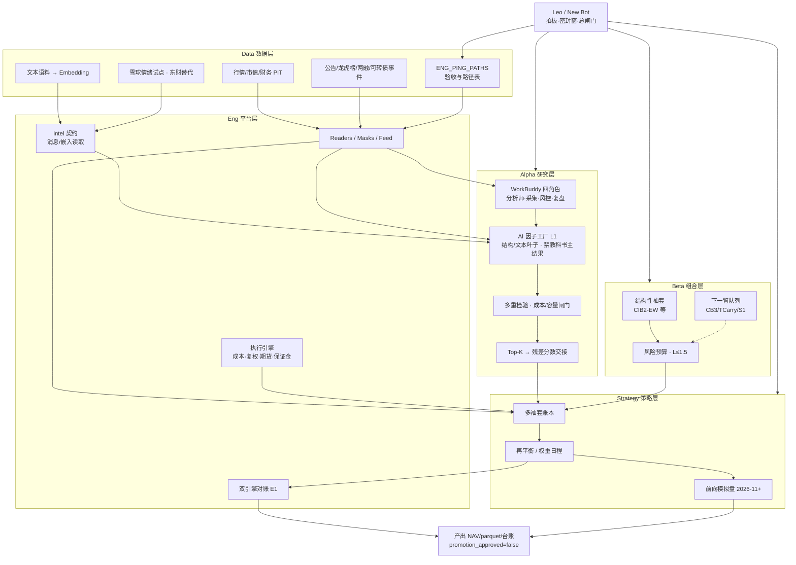
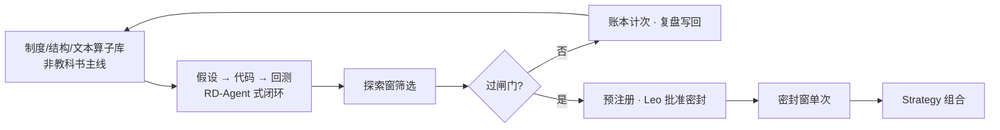

# QuantLab 系统架构总图（研究级）

更新日期：2026-10-11。权威细节见 `SYSTEM_ARCH_V3_ZH.md`、`SYSTEM_ARCH_V3_AI_NATIVE_ZH.md`。

## 端到端总览

## AI 挖因子特写

## 角色边界

| 角色 | 负责 | 不负责 |
|---|---|---|
| Data | 落盘、PIT、消息源 | 策略结论 |
| Eng | 读取器、掩码、引擎、对账、接口 | 因子是否有效 |
| Alpha | 挖因子、检验、WorkBuddy 流水线 | 改引擎默认 |
| Beta | 袖套、风险预算、结构性收益 | 改 D1 掩码 |
| Strategy | 组合账本、再平衡、模拟盘 | 伪造数据验收 |
| Leo | 密封/晋级拍板 | — |
