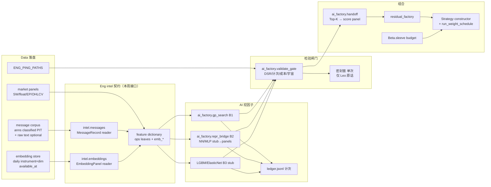
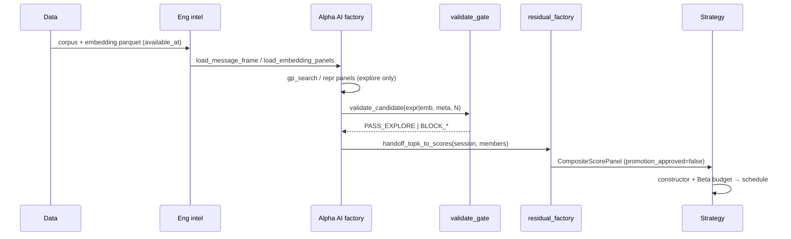

# QuantLab V3 AI-Native 架构修订

**角色**：Eng（平台）· 研究级 · 不发明 promotion 结论 · 不伪造回测数字  
**日期**：2026-10-11（ET）  
**基线**：`SYSTEM_ARCH_V3_ZH.md` + `SYSTEM_ARCH_V3_INTERFACES.md`  
**对齐**：`/workspace/QuantLab-AI_FACTOR_MINING_PLAN_ZH.md`、`docs/prereg/AI_FACTOR_L1.md`、`docs/v2/ALPHA_WORKBUDDY_PIPELINE_ZH.md`  
**总闸门**：`quantlab/promotion_gate.py` ← `output/d1/ENG_PING_PATHS.json`

> Leo（经 New Bot）判断：SYSTEM_ARCH_V3「太老、没用上 AI」。本文在 V3 之上补 **消息→嵌入→挖因子→检验→组合** 的 AI-native 目标架构，诚实标出现状差距，并冻结 **本周必须改的 Eng 接口**（仅平台面；不替 Alpha/Beta/Strategy 发明研究结论）。

---

## 1. 目标一句话

```
消息语料(PIT) → 嵌入/日级特征 → AI 挖因子(GP+表示学习+基线)
  → 多重检验/成本闸门 → 残差合成/袖套预算 → Strategy 组合与模拟盘
```

与 V3 主链路的关系：**不替换** Data→readers→masks→execution；在「情报/Alpha」段把桩换成可调用契约，并让 embedding 叶特征能进 `gp_search` / residual 交接。

---

## 2. 目标 AI-native 流（mermaid）



### 单日研究时序（目标）



---

## 3. 现状 vs 目标差距（诚实表）

| 能力 | 现状（2026-10-11 ET） | 目标 | 差距等级 |
|---|---|---|---|
| 消息语料落盘 | Data 有 `announcements_classified_pit`（~1.44M 行，rules_v2，窗口约 2020-01～2024-05；`available_at` 多为公告日 23:59） | Eng 稳定 MessageRecord 读取 + PIT 断言 + ENG_PING 键 | **中**：数据在，Eng 无统一 intel reader |
| 原始长文本 / 新闻流 | cninfo/eastmoney 目录存在；**无**生产级「每日情报」ingest 调度 | 可选 raw text 路径；日终批处理；非盘中偷看 | **高**：产品化流水线仍是桩 |
| Embedding 存储 | **无** `data/v2/.../embedding*.parquet`；计划稿 D4 路径未落地 | 日级 instrument×dim + model_id + available_at | **高**：schema + Data 合同未建 |
| market_observatory | `portfolio/market_observatory.py`：纯函数、调用方喂数、fail-closed；**不**读盘不拉网 | 保持 UI 辅助边界；**不**冒充 intel 产品 | **低**：边界正确，勿误用 |
| 公告粗类 → 因子 | `factors/event_pipeline.py` 骨架 + 分类表；规则极性/事件信号 | 粗类 one-hot **与** embedding 叶特征并行进工厂 | **中**：事件管线在，未接 embedding 叶 |
| AI Factor Factory L1 | `gp_search` + ledger + walk_forward_ic 桩；探索窗已批；密封未批 | 同上 + emb_* leaves + validate_gate + handoff | **中**：GP 可跑；无 LLM/密封闭环、无 emb |
| NN 表示学习 B2 | **无** 可调用 bridge；计划 A6 未实现 | 小 MLP 出 8–32 维 panel，只作候选因子 | **高**：本周仅 stub 接口 |
| LGBM/ElasticNet B3 | **无** 实现 | 同特征库基线；GP 打不赢则停晋级 | **高**：本周 stub |
| 密封 LLM 挖因子环 | **无**；禁止把探索指标写成密封通过；WorkBuddy YAML 为草案 | 人工+账本+Leo 原话；非自动 LLM 下单 | **高**：故意不做自动密封 |
| 接 D1 / paper | Top-K JSON 路径约定有；**未**正式 handoff→residual→paper | `handoff_topk_to_scores` → residual / Strategy | **中**：本周做 Eng 交接面 |
| 每日情报产品 | V3 标为 **桩**（G5） | 消息→摘要技能→特征；与 WorkBuddy 四角色对齐 | **高**：产品定义属 Alpha/New Bot；Eng 只给契约 |
| Promotion | 研究输出恒 `false`；dataset PASS ≠ 策略可上线 | 不变 | — |

**明确不做（本修订也不假装）：** 端到端黑箱直接出可执行仓位当唯一晋级依据；盘中偷看未到 `available_at` 的文本；无计次密封；复刻 XTX 做市。

---

## 4. 本周必须改的 Eng 接口

仅 Eng 拥有面。Alpha 消费挖因子/检验；Beta 只读预算字段不变；Strategy 消费 score panel；Data 供语料与 embedding 表。

### 4.1 一览

| ID | 模块路径 | 提议签名（摘要） | 消费者 | 兼容 |
|---|---|---|---|---|
| **W1** | `quantlab/intel/messages.py` | `load_message_frame(...)` / `MessageRecord` / `assert_pit_available` | Alpha event / AI factory / WorkBuddy 采集 | **新增**；不改 `event_pipeline` 旧路径 |
| **W2** | `quantlab/intel/embeddings.py` | `EmbeddingStoreSpec` / `load_embedding_panels(...)` / `embedding_leaf_names` | Alpha AI factory；ops 叶扩展 | **新增**；缺文件 → 空 panel + TODO，不抛致命 |
| **W3** | `quantlab/factors/ai_factory/repr_bridge.py` | `ReprBridgeConfig` / `panels_from_embedding_store(...)` / `run_repr_stub(...)` | Alpha B2 | **新增**；默认 NotImplemented 真训练 |
| **W4** | `quantlab/factors/ai_factory/validate_gate.py` | `validate_candidate(...)` → `ValidateVerdict` | Alpha 探索/复盘；风险审查技能 | **新增**；不触发密封 |
| **W5** | `quantlab/factors/ai_factory/handoff.py` | `handoff_topk_to_scores(...)` → `HandoffScorePanel` | Alpha→residual；Strategy 读 scores | **新增**；`promotion_approved` 恒 False |
| **W6** | `quantlab/factors/ops.py`（轻触） | 常量 `EMBEDDING_LEAF_PREFIX = "emb_"`；允许 panels 含 `emb_*` | GP `apply_expr` | **向后兼容**：未提供 emb_* 时行为与今相同 |
| **W7** | ENG_PING 合同键（Data 写、Eng 读） | `paths.intel_message_corpus` / `paths.embedding_store_daily`（提议名） | Eng readers | Eng **本周**用可选键 + 回退已知 anns 路径；Data 落地后切换 |

### 4.2 提议签名（冻结意图；实现可为 stub）

```python
# W1 — quantlab/intel/messages.py
from datetime import date, datetime
from typing import Mapping, Sequence, TypedDict
import pandas as pd

class MessageRecord(TypedDict, total=False):
    message_id: str
    instrument: str          # 可空（宏观/市场级）
    source: str              # cninfo | eastmoney | ...
    category: str            # rules_v2 subtype / coarse class
    polarity: float          # [-1, 1] or 0
    title: str
    available_at: datetime   # 强制 PIT 钟
    asof_session: date       # 首个可交易 session >= available_at
    content_hash: str
    payload_uri: str         # optional raw pointer; may be absent

def load_message_frame(
    *,
    start: date | None = None,
    end: date | None = None,
    instruments: Sequence[str] | None = None,
    categories: Sequence[str] | None = None,
    roots: object | None = None,
) -> pd.DataFrame:
    """Read classified PIT corpus. Missing path -> empty frame + caller TODO."""
    ...

def assert_pit_available(row: Mapping, decision_ts: datetime) -> None:
    """Raise if decision_ts < available_at (Asia/Shanghai wall)."""
    ...
```

```python
# W2 — quantlab/intel/embeddings.py
class EmbeddingStoreSpec(TypedDict, total=False):
    path: str
    model_id: str
    dim: int
    available_at_field: str  # default "available_at"
    session_field: str       # default "session"
    instrument_field: str    # default "instrument"
    value_cols: list[str]    # emb_0..emb_{dim-1} or vector column
    promotion_approved: bool # always false at store meta for research

def load_embedding_panels(
    *,
    start: date,
    end: date | None = None,
    instruments: Sequence[str] | None = None,
    spec: EmbeddingStoreSpec | None = None,
) -> dict[str, pd.DataFrame]:
    """Return {emb_i: wide DataFrame[session x instrument]}. Empty if missing."""
    ...

def embedding_leaf_names(dim: int, prefix: str = "emb_") -> tuple[str, ...]:
    ...
```

```python
# W3 — quantlab/factors/ai_factory/repr_bridge.py
@dataclass
class ReprBridgeConfig:
    model_id: str = "stub_mlp_v0"
    dim: int = 16
    lookback: int = 20
    promotion_approved: bool = False  # forced False

def panels_from_embedding_store(...) -> dict[str, pd.DataFrame]:
    """Thin alias over intel.embeddings.load_embedding_panels for GP panels merge."""
    ...

def run_repr_stub(...) -> dict:
    """Research stub: does NOT train. Returns meta + promotion_approved=False."""
    raise NotImplementedError("repr_train_pending_data_and_alpha_config")
```

```python
# W4 — quantlab/factors/ai_factory/validate_gate.py
@dataclass(frozen=True)
class ValidateVerdict:
    status: str  # PASS_EXPLORE | BLOCK_SEALED | BLOCK_COST | BLOCK_UNIVERSE | BLOCK_NO_LEDGER | BLOCK_LOOKAHEAD
    n_attempts: int
    notes: tuple[str, ...]
    promotion_approved: bool = False  # always False

def validate_candidate(
    *,
    engine: str,
    expr_str: str | None,
    window: str,
    universe: str,
    cost: float,
    ledger_path: Path | None = None,
    sealed_requested: bool = False,
    leo_seal_approved: bool = False,
) -> ValidateVerdict:
    """Never auto-approves sealed. sealed_requested without leo_seal_approved -> BLOCK_SEALED."""
    ...
```

```python
# W5 — quantlab/factors/ai_factory/handoff.py
@dataclass(frozen=True)
class HandoffScorePanel:
    session: date
    scores: Mapping[str, float]   # instrument -> score
    source: str                   # e.g. "ai_factor_l1_topk"
    member_exprs: tuple[str, ...]
    n_ledger: int
    promotion_approved: bool = False
    data_ready: bool = False
    todos: tuple[str, ...] = ()

def handoff_topk_to_scores(
    session: date,
    members: Sequence[str],
    *,
    top_k_path: Path | None = None,
    panels: Mapping[str, pd.DataFrame] | None = None,
    integrate: str = "equal_weight_z",
) -> HandoffScorePanel:
    """Map frozen Top-K exprs -> cross-section scores for residual/Strategy.
    Missing top_k / panels -> data_ready=False + todos; never promotion_approved True.
    """
    ...
```

### 4.3 非本周（明确推迟）

- 真 MLP/Transformer 训练与 GPU 编排
- 自动 LLM 挖因子写回 ledger（无人工复盘）
- 每日情报产品调度器 / 告警 bot
- 修改 Beta sleeve 或 Strategy paper runner 内部逻辑
- 触碰密封窗标签

---

## 5. 需 QuantLab Data 的数据合同

| 合同键（提议） | 内容 | PIT / available_at | 优先级 |
|---|---|---|---|
| `paths.intel_message_corpus` | 指向分类公告主表（可先别名现有 `announcements_classified_pit`） | 每行 `available_at`；决策截点上海 18:00 语境 | **P0**（别名即可） |
| `paths.intel_message_raw`（可选） | 原始标题/正文指针或旁路表 | 同 available_at；禁止无钟文本 | P1 |
| `paths.embedding_store_daily` | 日级 embedding parquet：`session, instrument, available_at, model_id, emb_0..emb_{d-1}`（或 `vector` + dim meta） | `available_at` ≥ 文本可知时刻；session = 首个可交易日 | **P0 schema**；向量可后填 |
| `acceptance.embedding_store_daily` | dataset 级 PASS 证据 | 覆盖率、空值、前视抽检 | 随数据 |
| 公告覆盖延伸 | 分类表窗口外（2018–2019、2024-06+）若 Alpha 要全样本 | 如实标缺口，不伪造 | P1 |

**Eng 读规则：** 键缺失 → 回退文档写明的已知路径；仍缺失 → 空面板 + `todos`，**不**编造 embedding。

Schema 草案（embedding 一行一标的一日）：

| 列 | 类型 | 说明 |
|---|---|---|
| `session` | date | 交易日（信号可交易日） |
| `instrument` | str | 标的 |
| `available_at` | datetime tz-aware | PIT 钟 |
| `model_id` | str | 可复现 |
| `dim` | int | |
| `emb_0` … `emb_{d-1}` | float32 | 或单一 `vector` list（Eng 展开） |
| `content_hash` | str | 对齐语料 |

---

## 6. Promotion / 研究级约束（不变）

| 规则 | 说明 |
|---|---|
| 本修订一切新 API | `promotion_approved=False`（dataclass 强制或 `__post_init__`） |
| dataset PASS | ≠ 策略/因子可上线 |
| 密封窗 2018-01～2024-05 | 仅 Leo 在 Alpha 聊天原话批准后单次；`validate_gate` 默认 BLOCK |
| 探索窗 | 可按 AI_FACTOR_L1 已批协议跑；计次进 ledger |
| Eng 不写 | 年化/Sharpe 晋级叙事；假 embedding；假回测 |

---

## 7. 与 V3 / WorkBuddy 文档关系

| 文档 | 关系 |
|---|---|
| `SYSTEM_ARCH_V3_ZH.md` | 主架构；§3.3/§3.5/G5/G6 指向本文 |
| `SYSTEM_ARCH_V3_INTERFACES.md` | 增补 PROPOSED / THIS_WEEK 行 |
| `ALPHA_WORKBUDDY_PIPELINE_ZH.md` | Alpha 四角色草案；消费 W1/W4/W5，不由 Eng 改角色结论 |
| `QuantLab-AI_FACTOR_MINING_PLAN_ZH.md` | L1/L2/L3 与 D4 embedding 计划权威 |
| `docs/prereg/AI_FACTOR_L1.md` | 探索已批、密封未批 |

---

## 8. 本周落地检查清单（Eng）

- [x] 本文 + V3 主文档链接 + INTERFACES PROPOSED 行
- [x] `quantlab/intel/` 消息/嵌入 stub
- [x] `ai_factory`：`repr_bridge` / `validate_gate` / `handoff` stub
- [ ] Data：ENG_PING 键别名 + embedding schema 空表或样例（**等 Data**）
- [ ] Alpha：把 emb_* / handoff 接进探索配置（**等 Alpha**）
- [ ] 真表示学习训练（非本周）

---

*Eng 维护。研究级。实现先于宣传；缺数据就空面板 + TODO。*

---

## 附录 O：开源 Eng 采纳（TradingAgents / QuantMind）

详见 [`OPENSOURCE_ENG_ADOPTION_ZH.md`](OPENSOURCE_ENG_ADOPTION_ZH.md)。摘要：

| 来源 | 决策 | Eng 落点 |
|---|---|---|
| TradingAgents `date_window` | **ADAPT** | `intel/asof_window.py` → messages/embeddings |
| TradingAgents 辩论 + settlement | **ADAPT** 契约；拒 LangGraph 整仓 | `intel/debate_ledger.py`（决策质量账本 ≠ 现金 NAV） |
| QuantMind `factor_pipeline` export | **ADAPT** dry_run 契约；拒 Alpha158 默认模板 | `factors/ai_factory/pipeline_export.py` |

**本周已做：** as_of 守卫 + 单测（未来公告注入必丢/strict 必炸）；辩论/export TypedDict 桩。  
**不做：** vendor 整仓；伪造回测；抬升 `promotion_approved`。
