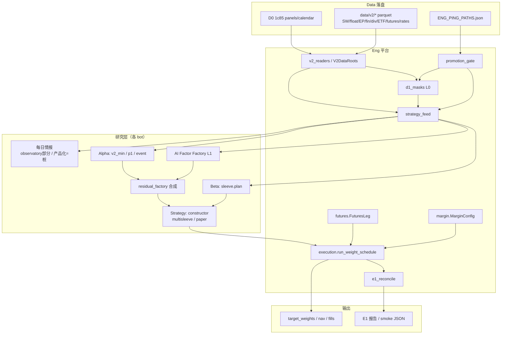
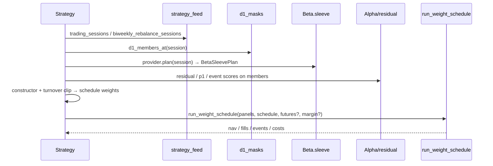

# QuantLab V3 可运行系统架构

**角色**：Eng（平台）落文档与接口契约  
**状态**：研究级（research-grade）· 不发明 promotion 结论 · 不伪造回测数字  
**日期**：2026-10-11（ET）  
**权威参数**：`docs/v2/QuantLab-MANDATE_V2.json` + `quantlab/mandate_v2.py`  
**总闸门**：`quantlab/promotion_gate.py` ← `output/d1/ENG_PING_PATHS.json`

> 本文描述**已存在可调用路径**与**诚实的桩/缺口**。Alpha / Beta / Strategy 的研究结论与预注册结论由各专属 bot 拥有；Eng 只提供数据契约、读取器、掩码、执行引擎与模拟盘脚手架。

---

## 1. 一句话流水线

```
数据落盘(Data) → Eng readers/masks → 每日情报(部分桩)
  → Alpha 研究流水线 / 多角色技能 → AI 因子工厂(L1 骨架)
  → 残差 Alpha 合成 → Beta 袖套/组合 → Strategy 构造/再平衡
  → 模拟盘(E1 执行引擎) → 输出(parquet/nav/json) + promotion 闸门
```

Mandate 四层（`architecture_layers`）：

| 层 | 含义 | 主要所有者 |
|---|---|---|
| L0 | 可交易宇宙掩码 | Eng（`d1_masks`）+ Mandate |
| L1 | Beta 袖套（现金 + 权益 ETF） | Beta（`beta/sleeve`）+ Eng 接口 |
| L2 | 风格风险预算（含微盘硬顶） | Strategy / Beta |
| L3 | 行业中性残差 Alpha 簿（30–60） | Alpha（因子）+ Strategy（组合） |

### 1.1 AI-Native 修订（2026-10-11）

Leo（经 New Bot）要求补「消息→嵌入→挖因子→检验→组合」的 AI-native 目标架构。

- **修订全文**：[`SYSTEM_ARCH_V3_AI_NATIVE_ZH.md`](SYSTEM_ARCH_V3_AI_NATIVE_ZH.md)（目标 mermaid、差距表、**本周必须改的 Eng 接口** W1–W7、Data 合同）
- **接口一览**：`SYSTEM_ARCH_V3_INTERFACES.md` 中标记 `PROPOSED / THIS_WEEK` 的行
- **桩模块**：`quantlab/intel/`、`quantlab/factors/ai_factory/{repr_bridge,validate_gate,handoff}.py`
- 研究级；不替换 §3 已冻结的 readers/masks/execution；缺 embedding 数据时返回空面板 + TODO

---

## 2. 角色边界（硬规则）

| 角色 | 拥有 | 不拥有 |
|---|---|---|
| **Data** | `data/v2/**` 落盘、验收证据、`ENG_PING_PATHS.json` 更新、公告核实 | 策略结论、引擎逻辑 |
| **Eng（本文）** | readers、masks、strategy_feed、execution / futures / margin、E1 reconcile、CLI smoke、平台文档、接口契约 | 因子有效性结论、组合研究结论、伪造 NAV/Sharpe |
| **Alpha** | 因子定义、IC/检验、事件流水线、AI 工厂搜索配置与预注册 | 改 Data 路径、改引擎默认成本 |
| **Beta** | 袖套权重逻辑、波动/β 目标、小盘卫星、期货 RP 等预注册 | 改 D1 掩码规则、改 promotion 总闸 |
| **Strategy** | paper runner、多袖套账本、再平衡与构造、成本对照臂 | 发明 Data 验收、改 Eng 执行默认 |
| **New Bot / Leo** | 任务分派、总闸门批准、密封窗批准、跨角色冲突仲裁 | — |

**Eng 明确不做**：把 process ICIR 写成「可上线」；把 dataset PASS 写成策略 promotion；补齐缺失数据时伪造行情。

---

## 3. 分层架构

### 3.1 Data 契约层

- **清单权威**：`output/d1/ENG_PING_PATHS.json`（`paths` / `bond_futures` / `rates` / `acceptance` / `promotion_approved_overall`）。
- **默认根**：`quantlab.data.v2_readers.V2DataRoots` / `default_v2_roots()`（见 `docs/v2/ACCEPTED_DEFAULTS.md`）。
- **合并面板**：D0 `data/local_market/1c85…` + 默认 extend `asof_extend_tushare_202610`（回退 `asof_extend_202610`）。
- **已验收数据集（dataset 级，以 ENG_PING `acceptance[key].pass` 为准）**：SW L1 tushare、float_mktcap daily、asof_extend、financials_pit_tushare、ep_pit_daily、ocf_to_profit、dividend 等。
- **单位**：`ENG_PING.units_note` — 优先 tushare extend（volume=股, amount=元）。

### 3.2 Eng readers / masks / feed

| 模块 | 职责 |
|---|---|
| `quantlab/data/v2_readers.py` | SW_L1 / float / EP / financials / ETF510300 / merge panel / dividends |
| `quantlab/universe/d1_masks.py` | L0：上市日、ST、U30、涨跌停、微盘剔除 → `D1MaskResult` |
| `quantlab/platform/strategy_feed.py` | Strategy paper 稳定 feed（分块 close、float32、双周再平衡、D1 成员） |
| `quantlab/mandate_v2.py` | Mandate 加载；`promotion_approved` 跟随总闸门 |
| `quantlab/promotion_gate.py` | `overall_promotion_approved()` / `dataset_accepted(key)` |

### 3.3 每日情报（现状诚实标注）

| 能力 | 状态 | 说明 |
|---|---|---|
| 组合市场观测 UI 辅助 | **部分存在** | `quantlab/portfolio/market_observatory.py`：只接受调用方已给的日线/HTML，fail-closed，不读盘、不拉网 |
| 公告 / 事件库存 | **Data 侧有落盘线索** | `ENG_PING` 有 `anns_*` / `event_flow_update`；Alpha 侧 `factors/event_pipeline.py` 可加载事件 parquet |
| 「每日情报」产品化流水线（自动摘要→因子→告警） | **桩 / 未产品化** | 产品定义仍属 Alpha/New Bot；Eng 本周起提供 `quantlab/intel/` 契约（见 AI-Native 修订） |
| 消息语料 reader / embedding store | **本周 stub** | `intel.messages` / `intel.embeddings`；Data 合同见 AI-Native §5 |

### 3.4 Alpha 研究流水线 / 多角色技能

| 路径 | 角色 | 说明 |
|---|---|---|
| `factors/v2_min_pipeline.py` | Eng 最小可跑 | M01 动量 + V01_EP；IC/ICIR = **process metric only** |
| `factors/residual_factory.py` | Eng 接口 + Research 实现 | 行业中性（SW_L1）±市值中性 → 等权 z 合成 |
| `factors/p1_factor_lib.py` + `p1_pipeline.py` | Alpha/Eng 研究 | 扩展动量/反转/价值/质量/低波/流动性；`run_p1_integrate_session` |
| `factors/event_pipeline.py` | Alpha | 事件信号面板 + process IC；依赖 Data 事件表 |
| `factors/ops.py` / `neutralize.py` / `orthogonalize.py` / `walk_forward.py` | 共享算子 | 供工厂与手工因子共用 |

**多角色技能（约定，非独立进程）**：Data 供数 → Eng 供掩码/面板 → Alpha 挖因子/检验 → Beta 给 β/波动预算 → Strategy 组合成簿。交接物为 typed panel / parquet / 预注册 md，不是口头结论。

### 3.5 AI 因子工厂（L1 骨架）

对齐：`QuantLab-AI_FACTOR_MINING_PLAN_ZH.md`、`docs/prereg/AI_FACTOR_L1.md`。

| 模块 | 状态 |
|---|---|
| `factors/ai_factory/search.py` (`gp_search`) | **可跑骨架**（GP，写入 ledger） |
| `factors/ai_factory/ledger.py` | `output/ai_factor/ledger.jsonl` 计次 |
| `factors/ai_factory/evaluate.py` / `fitness.py` | 折内 IC / 适应度桩 |
| 密封窗 2018-01～2024-05 | **禁止**直至 Leo 单次批准；工厂本身不触发密封 |
| `ai_factory/validate_gate.py` | **本周 stub**：探索 PASS / 密封默认 BLOCK |
| `ai_factory/handoff.py` | **本周 stub**：Top-K → score panel（接 residual/Strategy） |
| `ai_factory/repr_bridge.py` | **本周 stub**：B2 表示学习桥；真训练 NotImplemented |
| 消息嵌入叶 `emb_*` | **待 Data embedding 表**；ops 允许 panels 带前缀，无数据则不进搜索 |

KPI（本周级）：管线通 + ledger 计次 + Top-K 表达式 + **校验/交接接口可调用** —— **不是**再报公开策略年化。详见 `SYSTEM_ARCH_V3_AI_NATIVE_ZH.md`。

### 3.6 Beta 袖套 / 组合

| 模块 | 说明 |
|---|---|
| `beta/sleeve.py` | `PrototypeBetaSleeveProvider` / `VolTargetBetaSleeveProvider` → `BetaSleevePlan`（ETF 权重、现金、残差预算、回撤缩放、可选小盘卫星） |
| `beta/satellite.py` / `smallcap_sleeve.py` / `dd_brake.py` | Beta 研究扩展（Eng 不拥有结论） |
| 期货 / 多资产预注册 | 见 `docs/v2/V3_*PREREG.md`、`MULTIASSET_*`；**研究级** |

### 3.7 Strategy 构造 / 再平衡

| 模块 | 说明 |
|---|---|
| `portfolio/v2_rebalance.py` | `RebalanceScheduleV2`、双周节奏钩子（研究 stub 标记） |
| `portfolio/v2_constructor.py` | 持仓数 / 单票 / 行业帽 / 换手裁剪 |
| `portfolio/v2_strategy_paper*.py` | Strategy 拥有的 paper runner（Eng 只保 feed） |
| `portfolio/v2_multisleeve_book.py` | 多袖套账本（core/marp/cb/…）；调用 `run_weight_schedule` |
| `portfolio/forward_paper_book.py` | 前向模拟盘（限制见 STRATEGY_MULTISLEEVE_BOOK） |

### 3.8 模拟盘 / 执行引擎（E1）

| 模块 | 说明 |
|---|---|
| `platform/execution.py` | `run_weight_schedule`、`ExecConfig`、`load_execution_panels`、冲击成本、公司行为、容量曲线 |
| `platform/futures.py` | `FuturesLeg` / `FuturesConfig` / `load_futures_panels`（股指+国债多根） |
| `platform/margin.py` | `MarginConfig` 融资账户（默认关） |
| `platform/e1_reconcile.py` | 零成本双引擎对账 CLI（platform / ledger / fastsim） |
| `smallcap/sim.py` | 快仿（无期货腿时与平台对账） |

默认：`cash_rate=None`、`futures=None`、`margin=None` → 旧结果不变。三引擎零成本对账时须保持期货/融资/计息关闭。

### 3.9 输出

| 位置 | 内容 |
|---|---|
| `output/strategy_paper_v1/` / `output/strategy_paper_costs/` | Strategy paper |
| `output/strategy_mbook*` | 多袖套 |
| `output/e1_reconcile/` | E1 对账报告 |
| `output/ai_factor/ledger.jsonl` | AI 工厂账本 |
| `output/d1/ENG_PING_PATHS.json` | Data↔Eng 路径与验收 |
| `output/strategy_feed_cache/` | feed 可选磁盘缓存 |

---

## 4. 端到端流程图



### 单日再平衡时序（简化）



---

## 5. 最小接口契约（冻结可调用面）

下列签名以仓库代码为准；完整说明见同目录专项文档。一行契约副本：`docs/v2/SYSTEM_ARCH_V3_INTERFACES.md`。

### 5.1 Mandate / Gate

```python
from quantlab.mandate_v2 import load_mandate_v2
from quantlab.promotion_gate import overall_promotion_approved, dataset_accepted, gate_status

m = load_mandate_v2()                    # -> MandateV2
ok = overall_promotion_approved()        # 总闸；可被 OVERALL_PROMOTION_OVERRIDE 覆盖
sw = dataset_accepted("sw_l1_pit_tushare")
```

### 5.2 Readers / Roots

```python
from quantlab.data.v2_readers import (
    default_v2_roots, load_merged_panel, load_merged_calendar,
    load_sw_l1_members, float_mktcap_lookup_for_session,
    load_ep_research, load_financials_pit, load_dividends, load_etf_510300,
)
roots = default_v2_roots()
```

### 5.3 D1 Mask

```python
from quantlab.universe.d1_masks import build_d1_masks_for_session, D1MaskConfig, D1MaskResult
# 或 strategy_feed 封装：
from quantlab.platform.strategy_feed import d1_members_at, d1_members_at_chunked
members = d1_members_at(session, max_instruments=None)  # tuple[str, ...]
```

### 5.4 Strategy feed

```python
from quantlab.platform.strategy_feed import (
    trading_sessions, merged_close_panel, iter_merged_close_chunks,
    merged_daily_returns, biweekly_rebalance_sessions,
    etf_510300_daily_returns, describe_strategy_feed,
)
# 内存：chunk_size=200–400, dtype="float32"；returns 必须传 close_panel=
```

### 5.5 Beta sleeve

```python
from quantlab.beta.sleeve import VolTargetBetaSleeveProvider, BetaSleevePlan
plan: BetaSleevePlan = VolTargetBetaSleeveProvider(mandate).plan(session)
# 关键字段：etf_sleeve_weight, cash_weight, residual_book_weight_cap,
# residual_beta_budget_for_strategy, promotion_approved, todos
```

### 5.6 Residual / min / P1 / AI factory

```python
from quantlab.factors.residual_factory import (
    ResidualAlphaFactorFactory, ResearchResidualAlphaFactorFactory,
    equal_weight_zscore_integrate,
)
from quantlab.factors.v2_min_pipeline import run_v2_min_pipeline
from quantlab.factors.p1_pipeline import run_p1_integrate_session
from quantlab.factors.ai_factory import gp_search, GPConfig, append_attempt
# AI 工厂：promotion_approved 恒 False；密封窗不由此触发
```

### 5.7 Execution / futures / margin

```python
from quantlab.platform.execution import (
    ExecConfig, ExecPanels, load_execution_panels, run_weight_schedule,
    reconcile_zero_cost, cost_ladder, capacity_curve,
)
from quantlab.platform.futures import (
    FuturesLeg, FuturesPanels, FuturesConfig, load_futures_panels,
    load_shibor, load_lpr, load_511880_returns,
)
from quantlab.platform.margin import MarginConfig

panels, diag = load_execution_panels(ids, start, end)
leg = FuturesLeg(load_futures_panels(("IF", "T"), start, end),
                 FuturesConfig(roll_mode="roll", bond_margin_source="hist"))
mgn = MarginConfig(financing_rate=load_shibor("3M"), spread=0.01, max_leverage=3.0)
out = run_weight_schedule(panels, schedule, config=ExecConfig(...),
                          futures=leg, margin=mgn)  # futures/margin 默认 None
```

### 5.8 Rebalance / constructor（Strategy 常用 Eng 面）

```python
from quantlab.portfolio.v2_rebalance import RebalanceScheduleV2
from quantlab.portfolio.v2_constructor import PortfolioConstructorV2
```

### 5.9 E1 / Smoke CLI

```bash
PYTHONPATH=. /workspace/qlvenv/bin/python -m quantlab.v2_eng_smoke --max-instruments 50
PYTHONPATH=. /workspace/qlvenv/bin/python -m quantlab.platform.e1_reconcile --dry-run --out /tmp/e1_dry
PYTHONPATH=. /workspace/qlvenv/bin/python -m pytest tests/test_ai_factor_factory_smoke.py -q
```

---

## 6. Promotion 闸门

| 层级 | API / 字段 | 含义 |
|---|---|---|
| **数据集** | `dataset_accepted(key)` / ENG_PING `acceptance[key].pass` | 该表可被平台默认消费；**不是**策略可上线 |
| **总体** | `overall_promotion_approved()` / ENG_PING `promotion_approved_overall` | 数据/平台总闸；Leo 可批准或撤回；`OVERALL_PROMOTION_OVERRIDE` 可一键冻结 |
| **研究输出** | 几乎所有 factor / sleeve / paper meta 的 `promotion_approved=False` 或跟随总闸但标注 research | **默认研究级**；Eng 不把 total gate=true 写成组合结论 |

细则：`docs/v2/PROMOTION_ACCEPTANCE.md`、`ACCEPTED_DEFAULTS.md`。

---

## 7. 已知缺口 / 阻塞清单（不发明解法）

| ID | 缺口 | 影响 | 状态标注 |
|---|---|---|---|
| G1 | CB/ETF extend 完整性（见 `CB_ETF_DATA_STATUS.md`） | CB 袖套 / ETF 扩展模拟 | Data 进行中；引擎有 CB loader，覆盖待确认 |
| G2 | `fund_div` / 基金除权与 adj 假跳变 | ETF 公司行为；`fund_adj_factor_actions` 默认关 | 阻塞确认前勿开；510300 走旧 merge 路径 |
| G3 | 国债期货手续费无调整历史 | 成本敏感性 | **假设**（`BOND_FEE_ASSUMED=True`）：开/平昨 3 元、平今 0、交割 5 元 |
| G4 | 股指期货 FEE/MARGIN 表部分凭公告记忆 | IF 腿成本 | 已部分核实；敏感用 override |
| G5 | 每日情报产品化流水线缺失 | 「情报→因子」自动闭环 | **桩**；Eng 已给 `intel/` 契约，产品调度仍属 Alpha/New Bot；见 AI-Native |
| G6 | AI 因子工厂仅 L1 骨架 + 本周校验/交接 stub | 无密封窗结果、无上线叙事、无生产 embedding | GP+ledger 可跑；`validate_gate`/`handoff`/`repr_bridge` stub；禁止触密封 |
| G7 | Ledger / 快仿无期货腿、无融资、计息不全 | E1 三引擎对账范围 | 对账时关掉 futures/margin/cash_rate |
| G8 | 融券（股票卖空）不支持 | 多空簿 | 负股票权重被忽略 |
| G9 | asof_extend 早期 amount/limit/ST 缺口 | U30 研究 waive | 研究标记，非 promotion |
| G10 | 事件/资金流数据覆盖（`EVENT_FLOW_DATA_STATUS.md`） | 事件 Alpha | Data 状态见该文档 |
| G11 | Shibor/LPR 覆盖边界 | 现金计息 / 融资 | 见 rates parquet；缺段需 Data |
| G12 | 黄金 SHFE AU 期货腿未做 | 多资产 RP | 未实现 |

---

## 8. 相关文档索引

| 文档 | 用途 |
|---|---|
| `STRATEGY_PAPER_FEED.md` | feed 签名与内存旋钮 |
| `PROTO_MASK_BETA.md` / `ENG_SMOKE.md` | mask/Beta/最小因子 smoke |
| `EXECUTION_FUTURES_CASH.md` / `EXECUTION_COSTS_PLATFORM.md` | 执行、期货、融资 |
| `E1_RECONCILE.md` | 零成本对账 |
| `ACCEPTED_DEFAULTS.md` / `PROMOTION_ACCEPTANCE.md` | 默认路径与验收 |
| `STRATEGY_MULTISLEEVE_BOOK.md` | 多袖套（Strategy） |
| `PHASE0_SKELETON.md` | 早期骨架史 |
| `factors/ai_factory/README.md` | AI 工厂 KPI |
| `SYSTEM_ARCH_V3_INTERFACES.md` | 冻结 callables + PROPOSED/THIS_WEEK |
| `SYSTEM_ARCH_V3_AI_NATIVE_ZH.md` | AI-native 修订：消息→嵌入→挖因子→检验→组合 |

---

## 9. 需 Alpha / Beta / Strategy 后续充实的桩章节

1. **每日情报**：产品定义、调度仍属 Alpha/New Bot；Eng 契约见 `intel/` + AI-Native 修订（observatory 仍只做 UI 辅助）。
2. **AI 因子工厂 L2+**：算子扩展、真表示学习、与 residual_factory 的正式交接（`handoff` stub 已挂）、预注册单次密封流程（等 Leo）。
3. **事件 Alpha ↔ multisleeve `alpha_event`**：长表权重契约已有占位，信号生成属 Alpha。
4. **Beta 密封交接包**：行业轮动 / FUT-RP / CB 等预注册通过后的 frozen handoff 路径。
5. **Strategy 全市场 paper 运维**：Full D1 成本臂与 E1 对账的常态化报告模板（Eng 已给 CLI）。

---

*Eng 维护。研究级。修改接口前先更新本文件、`SYSTEM_ARCH_V3_INTERFACES.md` 与（若涉及 AI 链路）`SYSTEM_ARCH_V3_AI_NATIVE_ZH.md`。*
